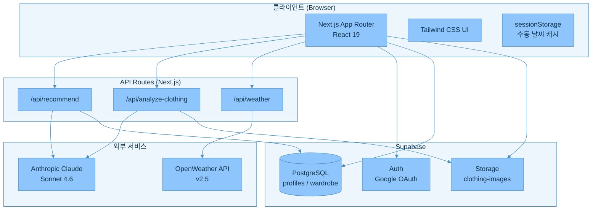
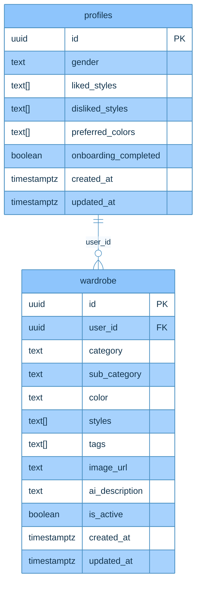
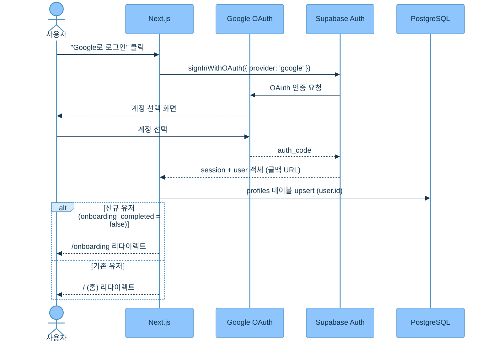
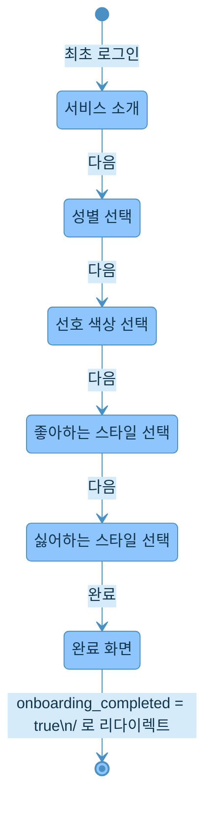
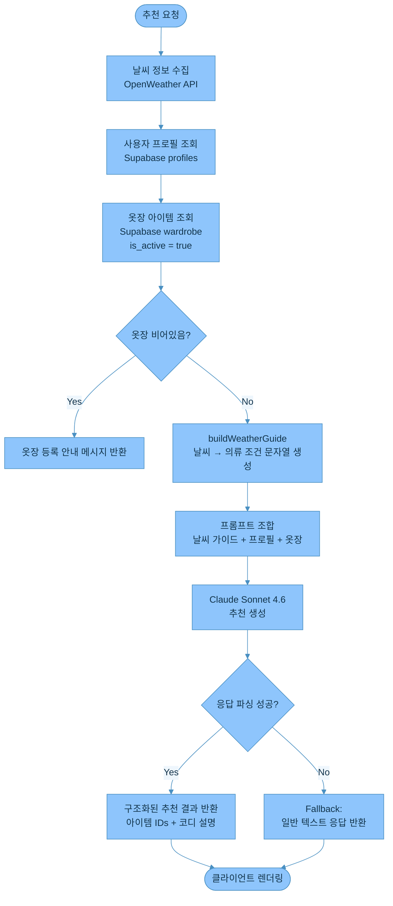

# 몇 도야? (myeotdoya)

내 옷장에서 오늘의 날씨를, 오늘의 옷차림으로.
매일 아침 5분을 당신께 돌려드립니다.

## 프로젝트 개요

사용자가 자신의 옷장을 등록하면, 현재 위치의 날씨와 개인 스타일 선호도를 바탕으로 AI가 오늘의 코디를 추천하는 웹 서비스.

| 항목 | 내용 |
|------|------|
| 프레임워크 | Next.js 15 (App Router) |
| 언어 | TypeScript |
| 스타일링 | Tailwind CSS |
| 데이터베이스 | Supabase (PostgreSQL + Storage) |
| 인증 | Supabase Auth (Google OAuth) |
| AI | Anthropic Claude Sonnet 4.6 |
| 날씨 | OpenWeather API v2.5 |
| 배포 | Vercel |

## 시스템 아키텍처



## 데이터베이스 스키마



## 인증 플로우



## 온보딩 플로우



온보딩은 `/onboarding` 단일 페이지에서 `step` 상태(0–5)로 관리됩니다. 각 스텝의 데이터는 로컬 `useState`에 누적되다가 마지막 스텝 완료 시 Supabase `profiles` 테이블에 한 번에 저장됩니다.

## 추천 파이프라인



## 디렉터리 구조

```
weather/
├── src/
│   ├── app/
│   │   ├── (auth)/
│   │   │   └── login/              # Google OAuth 로그인 페이지
│   │   ├── api/
│   │   │   ├── analyze-clothing/   # 의류 이미지 AI 분석
│   │   │   ├── recommend/          # 코디 추천 (메인 AI 로직)
│   │   │   └── weather/            # 날씨 데이터 프록시
│   │   ├── onboarding/             # 온보딩 5단계 플로우
│   │   ├── wardrobe/
│   │   │   ├── add/                # 옷 등록 (이미지 업로드 + AI 분석)
│   │   │   └── [id]/               # 옷 상세/편집
│   │   ├── layout.tsx
│   │   └── page.tsx                # 홈 (날씨 + 추천 결과)
│   └── lib/
│       ├── supabase/
│       │   ├── client.ts           # 브라우저용 Supabase 클라이언트
│       │   └── server.ts           # 서버용 Supabase 클라이언트 (쿠키 기반)
│       └── weather-guide.ts        # buildWeatherGuide 함수
├── public/
├── .env.local                      # 환경 변수 (Git 제외)
├── next.config.ts
└── tailwind.config.ts
```

## 환경 변수

| 변수 | 용도 | 사용 위치 |
|------|------|-----------|
| `NEXT_PUBLIC_SUPABASE_URL` | Supabase 프로젝트 URL | 클라이언트 + 서버 |
| `NEXT_PUBLIC_SUPABASE_ANON_KEY` | Supabase 익명 키 (RLS 적용) | 클라이언트 + 서버 |
| `SUPABASE_SERVICE_ROLE_KEY` | Supabase 서비스 롤 키 (RLS 우회) | 서버 전용 |
| `ANTHROPIC_API_KEY` | Claude API 키 | 서버 전용 |
| `OPENWEATHER_API_KEY` | OpenWeather API 키 | 서버 전용 |

## 핵심 모듈 설명

### `src/lib/weather-guide.ts`

`buildWeatherGuide(weather)` 함수가 정의되어 있습니다. OpenWeather 응답 객체를 받아 기온·강수·바람 세기를 "현재 기온 22°C (체감 20°C), 맑음, 바람 약함" 형태의 사람이 읽기 좋은 문자열로 바꿔 반환하며, 이 문자열이 Claude 추천 프롬프트에 삽입됩니다.

### `src/app/api/analyze-clothing/route.ts`

옷 등록 시 이미지를 분석하는 엔드포인트입니다.

1. 이미지를 Supabase Storage의 `clothing-images` 버킷에 업로드합니다.
2. 이미지 URL을 Claude에게 전달해 카테고리·색상·스타일 태그를 추출합니다.
3. 분석 결과를 `wardrobe` 테이블에 저장합니다.

### `src/app/page.tsx` (홈)

- 컴포넌트 마운트 시 Geolocation API로 위치를 수집합니다.
- 위치 또는 수동 날씨 데이터가 준비되면 `/api/recommend`를 호출합니다.

## 주요 설계 결정

### 소프트 삭제 (Soft Delete)

옷을 삭제할 때 행을 물리적으로 제거하지 않고 `is_active = false`로 설정합니다. AI 분석에 비용이 드는 이미지와 메타데이터를 보존하고, 향후 "삭제한 옷 복원" 기능을 위한 여지를 남기기 위함입니다. Supabase RLS 정책에서 `is_active = true` 필터를 적용해 일반 쿼리에는 비활성 행이 노출되지 않습니다.

### 룰 기반 필터링과 Claude 위임의 분리

날씨 조건 해석(기온 범위, 강수 여부, 바람 세기)은 `buildWeatherGuide`에서 결정론적 룰로 처리합니다. Claude에게는 이미 해석된 텍스트만 전달하고, 추천 로직(어떤 옷을 어떻게 조합하는지)만 Claude가 담당합니다. 이렇게 분리하면 날씨 해석 로직을 테스트하기 쉽고, Claude 프롬프트 변경 없이 날씨 조건을 수정할 수 있습니다.

### Supabase 클라이언트 이중화

브라우저용(`createBrowserClient`)과 서버용(`createServerClient`)을 분리합니다. 서버 클라이언트는 Next.js `cookies()` API로 세션 쿠키를 직접 읽고 씁니다. 이렇게 하지 않으면 SSR 환경에서 세션이 유실됩니다.

### 수동 날씨의 `sessionStorage` 캐싱

GPS를 허용하지 않는 사용자를 위한 수동 날씨 입력값을 `sessionStorage`에 저장합니다. `localStorage`를 쓰면 탭을 닫아도 유지되어 오래된 날씨 데이터로 잘못된 추천이 나올 수 있습니다. 세션 범위로 제한해 탭을 닫으면 자동으로 초기화됩니다.
